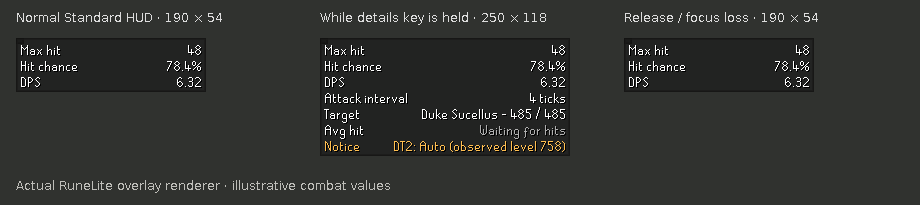

# Combat Insight 0.6.0 — local candidate testing

This candidate is for testing. It has not been published or tested in-game here. Some expanded-scope mechanics remain explicitly unavailable; see the coverage section below.

## Set up on Windows

The easiest route is the full-source ZIP. Extract it into a NEW folder, such as `D:\CombatInsight-0.6.0-test`, keeping the existing working project intact. In IntelliJ, Open the extracted `combat-insight` folder containing `build.gradle`. Wait for Gradle import. Open Terminal there:

```powershell
.\gradlew.bat clean test
.\gradlew.bat run
```

Use the development RuneLite that this opens. Avoid running two copies of Combat Insight in it. This does not update the Plugin Hub installation.

Alternative for your Git checkout: the cumulative patch is based on live0.5 commit `8cbdcf0d028c1c0b4146e798bb1f59890cfe2294`. Do not apply it to a checkout with other uncommitted edits. Check `git status --short` and `git log -1 --oneline` first, then:

```powershell
git apply --check "PATH\CombatInsight-0.6.0-local.patch"
git apply "PATH\CombatInsight-0.6.0-local.patch"
.\gradlew.bat clean test
.\gradlew.bat run
```

The patch includes new files. A blank successful `git apply --check` only checks; the second command applies it. Do not reapply the old0.4 or0.5 patches.

## Start with these quick checks

1. Existing Minimal/Standard/Advanced layouts, per-mode toggles, colours and compact spacing remain as saved.
2. Set HUD → Hold for Advanced details to a spare key. Hold it, release it, hold then Alt-Tab, change settings while held, and log out while held. Your configured mode must return without saving a different mode. Unbind it to disable.
3. Right-click the overlay using RuneLite's overlay menu gesture (normally Alt+right-click). Choose Copy diagnostic snapshot and paste into a text editor. Check target, gear totals, stats, rolls, notices; no account name/chat/world/location should appear.
4. Compare one familiar non-raid melee, ranged and magic setup to0.5. Check changing gear/prayer/stance immediately updates values.

## PNM and saved-spell fixes — October 1 refresh

This ZIP replaces the previous 0.6 candidate and retains its earlier changes. Extract into a new folder. The cumulative patch still starts from the released 0.5 baseline; do not apply it on top of the earlier 0.6 patch.

1. Leave Blood Blitz or Fire Surge saved and use **Combat type → Automatic**. Equip Voidwaker: regular melee max, accuracy and DPS must match the same setup with Manual magic spell set to Not set. With unchanged equipment, boosts, prayer and stance, spec maximum must also match. Your reported 43 regular / 64 spec setup is a useful comparison; those numbers are not universal.
2. With Voidwaker equipped, deliberately force Magic. The basic HUD now represents that requested spell, but Voidwaker's special must remain melee-derived. Other specials with incompatible forced types must show an explicit unavailable message. Return to Automatic afterward.
3. Switch among Shadow, trident and Sanguinesti with Fire Surge saved, then Not set. Compare damage and accuracy on the SAME target. A powered staff must never inherit the saved element or demonbane bonus.
4. Attack each PNM pillar with Shadow. Pillar magic damage is doubled; PNM herself must not receive the pillar multiplier. PNM pillar HP resolves to200 when the boss is visible; normal Nightmare uses300. If the encounter cannot be observed, HP stays unavailable while shared combat stats still permit damage calculations.
5. For a magic-damage special against an attackable pillar, the encounter multiplier applies once. Voidwaker uses its melee-derived roll before the magic pillar multiplier. The charged state must not retain the attackable state's calculation.
6. Watch Nylo switch forms, or a pillar charge. The confirmed actor's ID should refresh without requiring a fresh Attack click; leaving combat must not select an unrelated actor.
7. For intentional manual spellbook casting while a staff's melee stance is selected, explicitly set **Combat type → Magic**. Choosing a saved spell alone no longer overrides the stance. Switch back to Automatic for weapon swaps.
8. If using a salamander's Blaze attack at Ice demon, saved Fire/Demonbane spells must not remove its damage reduction or change its weapon speed.

Compare boosts and prayers at the same moment; send screenshots and a diagnostic snapshot for discrepancies. Windows Gradle and live combat validation are still required.

## Seeking arrows and Necklace of rupture (new September 30)

1. Tbow: compare ordinary amethyst arrows with Seeking amethyst arrows on the same target, keeping prayer, boosts and stance fixed. Normal maximum should match; Seeking accuracy and DPS should increase. Re-equipping the same stack must not accumulate bonuses.
2. Repeat with Seeking in Dizana's quiver and bolts in the worn ammo slot. Then equip ordinary compatible arrows in the worn slot: those should take priority over the Seeking stack in the quiver. Compare charged and uncharged quiver.
3. Swap Necklace of anguish for Necklace of rupture. Rupture contributes +20 ranged attack and +8 ranged strength in total (not on top of RuneLite's same bonuses). A +3 strength-bonus difference need not cross a max-hit breakpoint on every setup.
4. Repeat your three-person ToB Nylocas Vasilias ranged-phase test. Send the copied diagnostic snapshot and expected/actual maximum if it is still low. Seeking's floor alone does not explain a lower maximum.
5. Switch to Bowfa, a crossbow, melee and magic while Seeking arrows remain equipped: they must not receive the Seeking floor. Dark-bow basic attacks apply the floor per accurate arrow. Supported bow specials should update their average damage too.

Venator bounce DPS remains unavailable. These changes do not remove existing raid-special guards.

## DT2

Test whichever encounters you can safely access; don't spend orbs just for this test. Screenshots and a copied snapshot from normal encounters are useful first.

- Normal AND Awakened Duke, Whisperer, Leviathan and Vardorvis: Auto uses observed combat level. Check displayed target HP and mode notice. Whisperer phase IDs must keep the right variant.
- Normal/Awakened override: switch it while targeting the boss, then return to Auto. Tracked drain state must reset.
- Quest variants remain quest stats regardless of override. A Quest override on a shared post-quest ID must not pretend it is a quest NPC.
- Vardorvis: record at full, roughly half and low health. Normal Defence trends215→145, Awakened268→181; missing health should be unavailable. These are health-bar estimates.
- Duke: compare Emberlight/Arclight against a reference calculator with70% demonbane vulnerability; Leviathan melee stays immune.

## Specials and bolts

- Crystal/dragon halberd: one hit for1x1 target, two for a larger target; second accuracy reduced. Check Slash vs Stab selected offence.
- Fang: normal Stab and Slash damage ranges; special max uses true maximum; compare Stab accuracy outside and inside ToA.
- Scorching: demon target, direct damage unchanged by spec, bind/burn text separate from expected direct damage. Treat accuracy as provisional until compared in-game.
- Zaryte + ruby/diamond/onyx/dragonstone enchanted bolts, including dragon variants. Compare basic and special averages and max; diary setting changes proc mixture, not normal accuracy roll.
- Ruby: high and low target HP, a missing health bar, and low playerHP. Current-HP estimates can differ slightly from exact calculator inputs.
- Onyx against undead, dragonstone against dragons/fiery targets: effect should be blocked. Unsupported enchanted bolts should say unavailable instead of ordinary DPS.

## Raids

- CoX: observed party/mode enabled vs disabled; normal and CM; scaled party size. Confirm manual HP/Mining and manual ToB size are retained. Check leave/re-enter, logout and party changes for stale drains.
- VerzikP1 basic melee/ranged/magic: hits are capped10/3, expected damage uses a random cap. Compare P2/P3 to0.5.
- Guardian: melee pickaxes at different Mining levels; other weapons/styles must not show normal damage.
- Tekton magic, Vasa crystal magic, off-style Olm hands/head, Ice demon fire vs non-fire basic damage.
- Scythe and other supported basic multi-hit weapons apply each transform to each hitsplat.
- Existing raid immunity, phase changes, local defence/magic drains and infoboxes should still work.

## HUD preview



## Coverage and limitations

3976 NPC IDs retained; full Wiki data refresh blocked403. All four DT2 normal/Awakened variants are explicitly resolved. This does not mean every NPC or special weapon has been exhaustively verified.

Specials with pending raid transforms remain unavailable. Other enchanted bolt types and raid-transform/bolt combinations remain unavailable. ToB party size and CoX HP/Mining stay manual. Scorching source discrepancy and live health/phase behaviour need validation. Do not publish as a fully verified release based solely on automated tests.

## Send back

For each mismatch: weapon/ammo, boss and mode, prayer/stance, screenshot, expected reference values, and Copy diagnostic snapshot text. A simple pass/fail against the relevant rows above is enough for successful cases.

## Automated verification

Java11-target compilation and JUnit were run against real RuneLite1.12.39 libraries in this workspace. Python generator/comparison tests were run. Gradle bootstrap could not download here due network restrictions, so the Windows `clean test` and live run remain required. See `docs/research/060-verification.md` for final counts.
