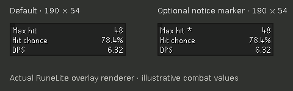

# Combat Insight 0.7.0 — local candidate testing

Includes all fixes from the latest 0.6 candidate. It has not been published or tested in-game here. Keep the working 0.5/0.6 project intact.

## Windows setup

1. Extract `CombatInsight-0.7.0-local-test.zip` into a new folder, such as `D:\CombatInsight-0.7.0-test`.
2. IntelliJ → Open → the extracted `combat-insight` folder containing `build.gradle`. Wait for Gradle import.
3. Run these in that project's terminal:

```powershell
.\gradlew.bat clean test
.\gradlew.bat run
```

Use the development RuneLite this launches, with only one copy of Combat Insight enabled. Alt-right-click the overlay and copy diagnostics: the first line must identify `0.7.0-local.1`. This does not update the Plugin Hub installation.

The optional cumulative patch is based on live 0.5 commit `8cbdcf0d028c1c0b4146e798bb1f59890cfe2294`. It is **not** an incremental patch on top of 0.6. Use the ZIP if your checkout already contains another local patch. For a clean checkout at that exact baseline:

```powershell
git status --short
git log -1 --oneline
git apply --check "PATH\CombatInsight-0.7.0-local.patch"
git apply "PATH\CombatInsight-0.7.0-local.patch"
.\gradlew.bat clean test
.\gradlew.bat run
```

A blank successful `--check` means only that the check passed. The second command applies it. Never use reset/clean commands to discard your existing work.

## New controls — quick tests first

| Test | Expected result |
| --- | --- |
| Leave new settings at defaults | Same compact layout and saved Minimal/Standard/Advanced row selections; no new default HUD row |
| Target reductions → Off (base stats) | Your later specials do not lower the plugin's target Defence/Magic or raise accuracy from local drains; infobox visibility remains controlled separately |
| Switch back to Track my reductions | Old reductions do not return; new supported specials begin recording again |
| Alt-right-click HUD → Clear tracked reductions | Estimates return to base without losing detection of the next special; it resets estimates for all tracked targets |
| Tekton after a DWH/elder-maul attempt, then reset/toggle Off | First-special guaranteed accuracy must not reappear. Off with no observed history says history unknown |
| Enable HUD → Show input notice marker | Asterisk on Max hit when there are notices; no extra row/height. Disable to restore the exact normal label |
| Save Fire Surge then use a melee weapon or Shadow | Damage matches Not set; Advanced/diagnostics explain that the saved spell is ignored |
| Deliberately force Combat type → Magic | Notice identifies forced type; restore Automatic for weapon swapping |
| Copy diagnostic snapshot | Version, boosted stats, target/phase evidence, active ammo, manual/observed raid inputs, tracking mode and limitations are included; no account/chat/world/location |

## Experimental ToB observation

Default is **off**, so your manual starting party size continues to apply. If testing automatic observation, enable it **before entering** and compare diagnostics with the actual starting team size. Dead players still count. Room loading or a disappearing orb must not shrink the previously observed size. Leaving/logout resets it; a new smaller raid must not inherit the previous team size.

Reconnecting or enabling mid-raid can miss departed players. Use manual starting size in that case. If observation is missing/invalid before any valid roster, the saved manual size is used. It does not read Party Hub.

## Visual preview



Both examples use the same compact footprint; the marker is optional. The existing held-Advanced key still exposes your selected Advanced rows and restores the normal mode on release/focus loss.

## PNM and saved-spell fixes — October 1 refresh

These earlier 0.6 fixes are included in 0.7. Test them in the 0.7 development client.

1. Leave Blood Blitz or Fire Surge saved and use **Combat type → Automatic**. Equip Voidwaker: regular melee max, accuracy and DPS must match the same setup with Manual magic spell set to Not set. With unchanged equipment, boosts, prayer and stance, spec maximum must also match. Your reported 43 regular / 64 spec setup is a useful comparison; those numbers are not universal.
2. With Voidwaker equipped, deliberately force Magic. The basic HUD now represents that requested spell, but Voidwaker's special must remain melee-derived. Other specials with incompatible forced types must show an explicit unavailable message. Return to Automatic afterward.
3. Switch among Shadow, trident and Sanguinesti with Fire Surge saved, then Not set. Compare damage and accuracy on the SAME target. A powered staff must never inherit the saved element or demonbane bonus.
4. Attack each PNM pillar with Shadow. Pillar magic damage is doubled; PNM herself must not receive the pillar multiplier. PNM pillar HP resolves to200 when the boss is visible; normal Nightmare uses300. If the encounter cannot be observed, HP stays unavailable while shared combat stats still permit damage calculations.
5. For a magic-damage special against an attackable pillar, the encounter multiplier applies once. Voidwaker uses its melee-derived roll before the magic pillar multiplier. The charged state must not retain the attackable state's calculation.
6. Watch Nylo switch forms, or a pillar charge. The confirmed actor's ID should refresh without requiring a fresh Attack click; leaving combat must not select an unrelated actor.
7. For intentional manual spellbook casting while a staff's melee stance is selected, explicitly set **Combat type → Magic**. Choosing a saved spell alone no longer overrides the stance. Switch back to Automatic for weapon swaps.
8. If using a salamander's Blaze attack at Ice demon, saved Fire/Demonbane spells must not remove its damage reduction or change its weapon speed.

Compare boosts and prayers at the same moment; send screenshots and a diagnostic snapshot for discrepancies. Windows Gradle and live combat validation are still required.

## Seeking arrows and Necklace of rupture (new September 30)

1. Tbow: compare ordinary amethyst arrows with Seeking amethyst arrows on the same target, keeping prayer, boosts and stance fixed. Normal maximum should match; Seeking accuracy and DPS should increase. Re-equipping the same stack must not accumulate bonuses.
2. Repeat with Seeking in Dizana's quiver and bolts in the worn ammo slot. Then equip ordinary compatible arrows in the worn slot: those should take priority over the Seeking stack in the quiver. Compare charged and uncharged quiver.
3. Swap Necklace of anguish for Necklace of rupture. Rupture contributes +20 ranged attack and +8 ranged strength in total (not on top of RuneLite's same bonuses). A +3 strength-bonus difference need not cross a max-hit breakpoint on every setup.
4. Repeat your three-person ToB Nylocas Vasilias ranged-phase test. Send the copied diagnostic snapshot and expected/actual maximum if it is still low. Seeking's floor alone does not explain a lower maximum.
5. Switch to Bowfa, a crossbow, melee and magic while Seeking arrows remain equipped: they must not receive the Seeking floor. Dark-bow basic attacks apply the floor per accurate arrow. Supported bow specials should update their average damage too.

Venator bounce DPS remains unavailable. These changes do not remove existing raid-special guards.

## DT2

Test whichever encounters you can safely access; don't spend orbs just for this test. Screenshots and a copied snapshot from normal encounters are useful first.

- Normal AND Awakened Duke, Whisperer, Leviathan and Vardorvis: Auto uses observed combat level. Check displayed target HP and mode notice. Whisperer phase IDs must keep the right variant.
- Normal/Awakened override: switch it while targeting the boss, then return to Auto. Tracked drain state must reset.
- Quest variants remain quest stats regardless of override. A Quest override on a shared post-quest ID must not pretend it is a quest NPC.
- Vardorvis: record at full, roughly half and low health. Normal Defence trends215→145, Awakened268→181; missing health should be unavailable. These are health-bar estimates.
- Duke: compare Emberlight/Arclight against a reference calculator with70% demonbane vulnerability; Leviathan melee stays immune.

## Specials and bolts

- Crystal/dragon halberd: one hit for1x1 target, two for a larger target; second accuracy reduced. Check Slash vs Stab selected offence.
- Fang: normal Stab and Slash damage ranges; special max uses true maximum; compare Stab accuracy outside and inside ToA.
- Scorching: demon target, direct damage unchanged by spec, bind/burn text separate from expected direct damage. Treat accuracy as provisional until compared in-game.
- Zaryte + ruby/diamond/onyx/dragonstone enchanted bolts, including dragon variants. Compare basic and special averages and max; diary setting changes proc mixture, not normal accuracy roll.
- Ruby: high and low target HP, a missing health bar, and low playerHP. Current-HP estimates can differ slightly from exact calculator inputs.
- Onyx against undead, dragonstone against dragons/fiery targets: effect should be blocked. Unsupported enchanted bolts should say unavailable instead of ordinary DPS.

## Raids

- CoX: observed party/mode enabled vs disabled; normal and CM; scaled party size. Confirm manual HP/Mining are retained; ToB remains manual unless its separate experimental observer is enabled. Check leave/re-enter, logout and party changes for stale drains.
- VerzikP1 basic melee/ranged/magic: hits are capped10/3, expected damage uses a random cap. Compare P2/P3 to0.5.
- Guardian: melee pickaxes at different Mining levels; other weapons/styles must not show normal damage.
- Tekton magic, Vasa crystal magic, off-style Olm hands/head, Ice demon fire vs non-fire basic damage.
- Scythe and other supported basic multi-hit weapons apply each transform to each hitsplat.
- Existing raid immunity, phase changes, local defence/magic drains and infoboxes should still work.

## Coverage and verification

3,976 NPC IDs, including 160 CoX/ToB rows; 35 special-weapon entries. These counts do not mean every phase/mechanic/weapon is verified. See [coverage audit](docs/research/070-coverage.md). Automatic spell selection, an exhaustive fresh NPC import, all remaining specs, and Party Hub integration are not part of this candidate.

Compiled against real RuneLite 1.12.39 libraries with Java 11 target; automated test counts are in `docs/research/070-verification.md`. Standard Gradle bootstrap is blocked by network access here, so Windows `clean test` and in-game tests remain required.

For a mismatch, send the copied diagnostic snapshot plus screenshot, boss/mode, gear/ammo, prayer/stance and expected reference result. For successful checks, the row name and pass/fail are enough.
